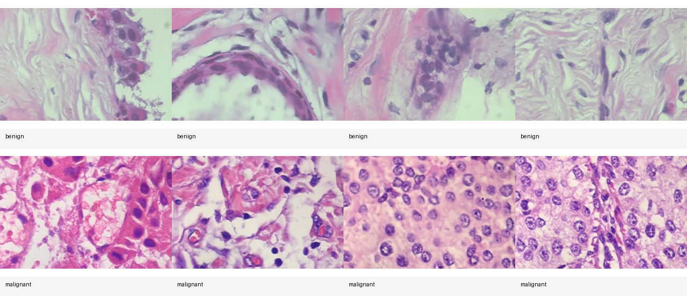
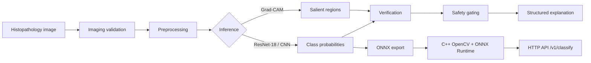
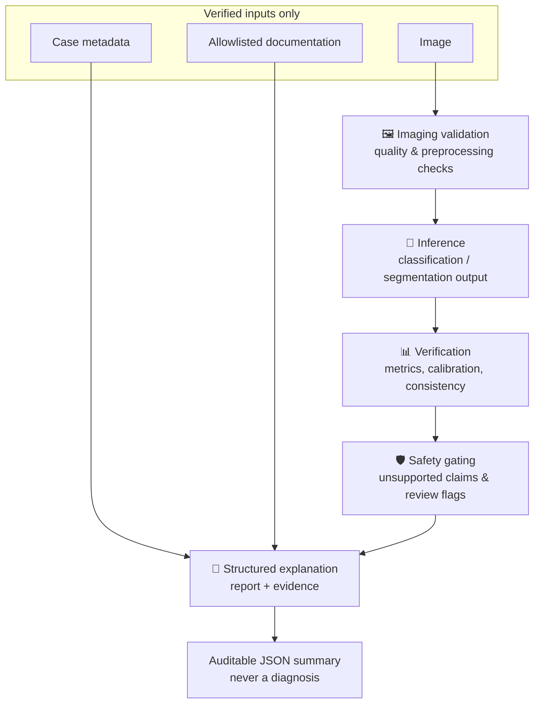
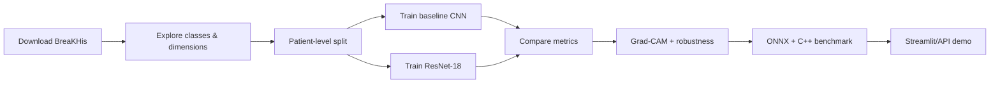
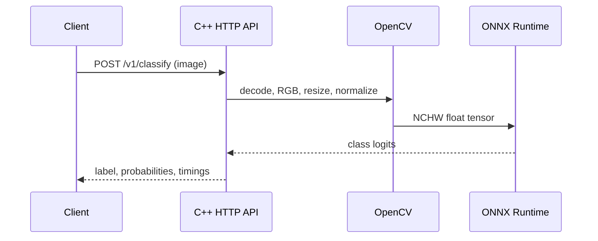

<div align="center">

# 🔬 MedVision – Safety-Aware Breast Histopathology AI & C++ Inference

### Deep learning · Explainable AI · ONNX · C++ deployment · Safety-first reporting

<p>
  
  
  
  
</p>

<p>
  <a href="https://www.kaggle.com/datasets/forderation/breakhis-400x">Dataset</a> ·
  <a href="cpp/README.md">C++ deployment</a> ·
  <a href="assistant/README.md">Constrained assistant</a> ·
  <a href="segmentation/README.md">Segmentation prototype</a>
</p>

<p><strong>A safety-aware medical-imaging research prototype from patient-disjoint evaluation to native C++ inference.</strong></p>

</div>

> ⚠️ **Medical safety notice:** This is an educational/research prototype, not a medical device and not a diagnostic system. It must not be used to make clinical decisions.

## CV presentation

**MedVision – Safety-Aware Breast Histopathology AI & C++ Inference**

> Built a safety-aware medical-imaging research prototype combining
> patient-disjoint deep-learning evaluation, Grad-CAM, calibration and
> robustness testing with ONNX/C++ inference and deterministic evidence-based
> reporting; designed explicit safety gates for uncertain and unsupported
> outputs.

---

## ✨ Project at a glance

| Capability | Implemented |
|---|:---:|
| BreaKHis 400X exploration | ✅ |
| ResNet-18 transfer learning | ✅ |
| Patient-grouped validation pipeline | ✅ |
| Sensitivity, specificity, F1, ROC-AUC, PR-AUC | ✅ |
| Calibration and uncertainty signals | ✅ |
| Grad-CAM explanations | ✅ |
| Blur/contrast/brightness/JPEG robustness | ✅ |
| ONNX export | ✅ |
| Native C++ HTTP inference service | ✅ |
| Streamlit upload demo | ✅ |
| Constrained evidence-cited assistant | ✅ |
| Expert pixel masks / U-Net | ⏳ Requires reviewed annotations |

## 🖼️ Visual overview

### Representative histopathology images

The gallery below shows a small, representative sample from the downloaded
BreaKHis 400X data: benign examples on the first row and malignant examples on
the second row. These labels come from the dataset; visual appearance alone
must not be interpreted as a diagnosis.

<p align="center">
  
</p>

<p align="center"><em>Representative dataset samples — benign (top) and malignant (bottom), for research visualization only.</em></p>

### System architecture



### Deterministic clinical-safety pipeline



### Reproducible ML workflow



## 📈 Initial reference results

The first notebook run achieved the following on the supplied test split. These
are baseline notebook results, not results from the newer patient-disjoint
advanced pipeline:

| Metric | Result |
|---|---:|
| Accuracy | **80.37%** |
| ROC-AUC | **0.9125** |
| Benign F1 | **0.7434** |
| Malignant F1 | **0.8410** |

<details>
<summary>Confusion matrix interpretation</summary>

- 155 benign images correctly classified
- 21 benign images classified as malignant
- 283 malignant images correctly classified
- 86 malignant images classified as benign

The false-negative count is why accuracy alone is insufficient and why this
prototype must not be interpreted as a clinical diagnostic tool.

</details>

## 🧰 Repository map

```text
oncology/
├── 01_breakhis_exploration.ipynb     # dataset exploration
├── 02_breakhis_training.ipynb        # notebook baseline
├── src/
│   ├── advanced_pipeline.py          # metrics, Grad-CAM, calibration, ONNX
│   ├── train_advanced.py             # grouped training + robustness artifacts
│   └── clinical_safety_pipeline.py   # validation → inference → safety → report
├── assistant/
│   ├── explain_outputs.py             # constrained evidence summarizer
│   └── medical_imaging_documentation.json
├── segmentation/
│   ├── validate_masks.py              # image/mask pair validation
│   └── generate_pseudo_masks.py       # demo-only heuristic masks
├── cpp/
│   ├── inference.cpp                  # OpenCV preprocessing + ONNX inference
│   ├── server.cpp                     # /health and /v1/classify
│   └── benchmark.cpp                  # latency and tensor-memory benchmark
├── app.py                             # Streamlit inference demo
├── requirements.txt
└── .gitignore
```

## 🚀 Quick start

### 1. Install Python dependencies

```powershell
python -m venv .venv
.\.venv\Scripts\Activate.ps1
python -m pip install -r requirements.txt
```

### 2. Download the dataset

```python
import kagglehub
path = kagglehub.dataset_download("forderation/breakhis-400x")
print(path)
```

Then use:

```python
DATASET_ROOT = Path(path) / "BreaKHis 400X"
```

### 3. Run the advanced pipeline

```powershell
python src\train_advanced.py `
  --dataset-root "C:\path\to\BreaKHis 400X" `
  --model baseline

python src\train_advanced.py `
  --dataset-root "C:\path\to\BreaKHis 400X" `
  --model resnet18
```

Generated artifacts include metrics JSON, robustness JSON, Grad-CAM, PyTorch
weights, and ONNX weights under `artifacts/`.

### 4. Launch the demo

```powershell
streamlit run app.py
```

The demo displays a model output, confidence signal, low-confidence review
flag, and Grad-CAM visualization. It does not diagnose.

## ⚙️ Native C++ deployment

The C++ service mirrors the Python preprocessing contract:



See [`cpp/README.md`](cpp/README.md) for CMake configuration, API examples,
and the latency benchmark. The service exposes:

```text
GET  /health
POST /v1/classify  multipart field: image
```

## 🤖 Constrained explanation layer

The assistant under [`assistant/`](assistant/) is intentionally deterministic.
It reads only:

1. verified model output;
2. case metadata;
3. predefined allowlisted documentation.

It produces structured fields for model label, confidence, uncertainty,
location when verified metadata exists, salient-region artifacts, limitations,
and evidence sources. It never accesses the original image, the internet, or
an unrestricted language model. The pipeline is deliberately described as
deterministic components rather than autonomous “agents”.

## 🧩 Segmentation status

BreaKHis 400X provides image-level labels but no reviewed pixel-level masks.
Therefore:

- `segmentation/validate_masks.py` validates genuine manually reviewed masks;
- `generate_pseudo_masks.py` creates **demo-only heuristic artifacts**;
- pseudo-masks must not be used as medical ground truth;
- U-Net/UNet++ training requires a separate reviewed mask dataset.

## 🔐 Safety and limitations

- Research prototype; not a medical device.
- Dataset shift and external validity are not established.
- Confidence is not a calibrated clinical probability.
- Grad-CAM is an explanation artifact, not a lesion segmentation.
- Low-confidence or inconsistent cases require qualified human review.
- Patient-level grouping should be preserved for every evaluation.
- Any future segmentation masks require expert annotation and quality review.

## 📚 Citation and data

The project uses the public
[BreaKHis 400X dataset](https://www.kaggle.com/datasets/forderation/breakhis-400x).
Please follow the dataset’s stated terms and cite the original dataset
publication when presenting results.

<div align="center">

### Built as a research prototype for explainable, deployment-aware medical imaging

</div>
